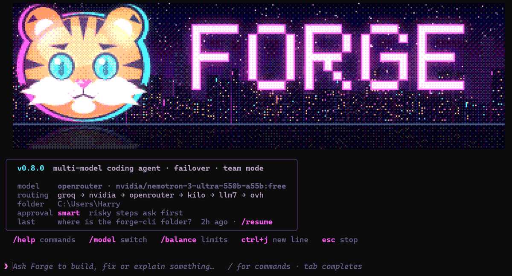
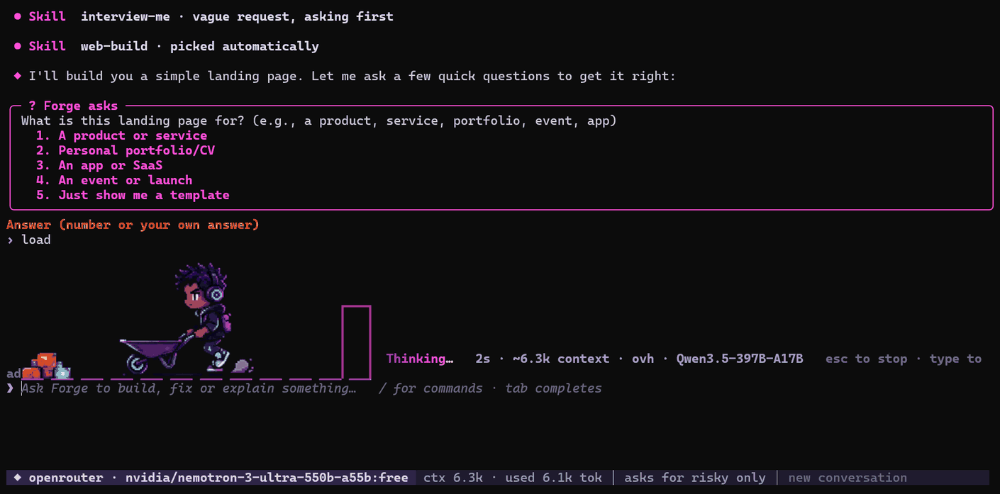
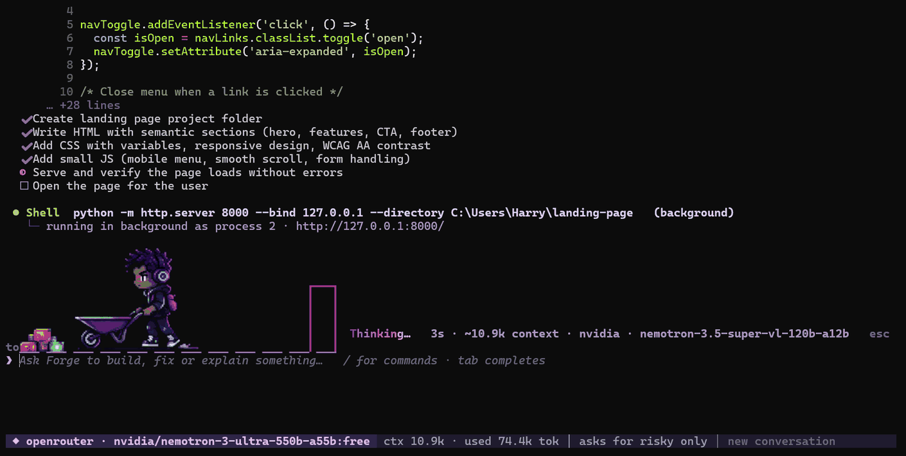

<div align="center">


**A coding agent for your terminal that never stops at a rate limit.**<br>
Forge reads and edits your files and runs commands. Bring your own API keys from as many
providers as you like; when one is busy, the next one picks up the same conversation.

[](https://pypi.org/project/forgecommandline/)


```powershell
pipx install forgecommandline
```

</div>

---

## What it looks like

These are real screenshots from Windows Terminal. Run `forge` in any project folder:



While it works, a courier pushes a wheelbarrow of parcels along the status line instead of a
spinner. Skills it picks, questions it asks and its replies all appear in the chat:



<p align="center"></p>

With `/city on`, a pixel city sits above the message box and its workers act out the same
events; a green DONE sign lights up when a turn finishes:



| What you see | Meaning |
|---|---|
| `● Skill  web-build · picked automatically` | Forge matched your request to a skill locally (no model call) and loaded its instructions |
| `● Write` · `● Update` · `● Shell` | every file change and command, with a preview, a coloured diff, or the first lines of output |
| `◆` | Forge's reply, followed by who answered, how long it took and how many tokens it used |
| `? Forge asks` | a question with numbered answers; type a number or your own answer |
| `⚠ … → trying the next one` | a provider failed; the next one continues the same turn, nothing is lost |
| `Thinking… 2s · ~6.3k context · ovh · …` | what is running right now; type to queue your next message |
| bottom bar | current model, context size, approval mode, conversation title |

In a terminal without sixel graphics (anything older than Windows Terminal 1.22, or not
WezTerm), the art is drawn with half-block characters instead.

When a step is risky, Forge stops and asks:

```text
┌─ ? Delete C:\Users\you\projects\site\old ─────────────────────────────────┐
│ needs your OK: deletes files                                              │
└───────────────────────────────────────────────────────────────────────────┘
  Allow? yes · always for this kind · no ›
```

`/exit` prints how to get back: `forge -c` continues the conversation in that folder, and
`forge -r <id>` opens it from anywhere.

---

## Install

| Way | Command |
|---|---|
| pipx (recommended) | `pipx install forgecommandline` |
| pip | `python -m pip install forgecommandline` |
| Windows exe, no Python | download `forge-vX.Y.Z-windows-x64.zip` from Releases, unzip, put `forge.exe` on your PATH |
| From source | `python -m pip install .` in this folder, or run `forge.cmd` directly |

The command is `forge` whichever way you install it.

## First run

```powershell
forge
```

The first interactive launch opens `/setup`, which adds a provider key. You can also paste a
key straight into the chat (Forge recognises it, files it under the right provider and redacts
it before anything is sent or saved) or use `/keys add`.

Forge doesn't come with keys of its own: it runs on yours. Free-tier keys from Groq, NVIDIA,
OpenRouter, Cerebras or Gemini are enough to start, and every extra key or provider you add is
one more place to fail over to. (A few public keyless gateways, kilo, llm7 and ovh, sit at the
very end of the chain as a last resort; they are slow and rate limited, so don't rely on them.)

```text
forge                         chat in the current folder
forge -c                      continue the last conversation here
forge -r [#|id]               pick a saved conversation, or jump to one
forge "fix the failing test"  one prompt, then exit
forge -m qwen/qwen3-32b       use a model for this run (or -m groq:qwen/qwen3-32b)
forge -p openrouter           use only one provider for this run
forge -t                      start in team mode
forge -y                      auto-approve everything (careful)
forge -v                      show the key rotation and failover log
forge --status | --sessions | --version
```

## At the prompt

| Keys | |
|---|---|
| <kbd>Enter</kbd> | send |
| <kbd>Ctrl</kbd>+<kbd>J</kbd> · <kbd>Alt</kbd>+<kbd>Enter</kbd> · line ending in `\` | new line |
| <kbd>Ctrl</kbd>+<kbd>V</kbd> | paste text |
| <kbd>Alt</kbd>+<kbd>V</kbd> | paste an image, file or path from the clipboard as an attachment |
| <kbd>Tab</kbd> | complete commands, models, skills, session numbers |
| <kbd>↑</kbd> <kbd>↓</kbd> | history |
| <kbd>Esc</kbd> · <kbd>Ctrl</kbd>+<kbd>C</kbd> | stop a reply |
| <kbd>Ctrl</kbd>+<kbd>D</kbd> | quit |

The message box stays open while Forge works, so you can type the next request; it is sent
when the current one finishes. Images go only to a model that can see them.

| Commands | |
|---|---|
| `/model` · `/model <provider> <model>` · `/models [provider] [filter]` | see, switch, list models |
| `/provider <name>` · `/provider auto` | pin one provider, or back to failover |
| `/sessions` · `/resume` · `/rename` · `/delete` · `/new` | saved conversations |
| `/undo` · `/plan <request>` | undo the last change · explore read-only, then do it |
| `/skills [words]` · `/skill <name> [request]` · `/<name>` | find and run skills |
| `/approve smart\|ask\|auto` · `/yes` | approval mode |
| `/parallel …` · `/team on` · `/roster` | several agents at once, coordinator mode, who's on the team |
| `/status` · `/balance` · `/cost` · `/doctor` | keys and rests, limits left, money spent, health |
| `/keys [add\|test\|remove]` · `/setup` | manage keys |
| `/github login\|status\|logout` · `/review` | GitHub sign-in · review the current diff |
| `/memory` · `/commands` · `/city` · `/ads` · `/help` · `/exit` | |

---

## How failover works

```text
 your request
      │
      ▼
 ┌─────────┐ 429  ┌─────────┐ timeout ┌────────────┐      ┌──────────────────┐
 │  groq   │─────▶│ nvidia  │────────▶│ openrouter │─ … ─▶│ kilo · llm7 · ovh│
 └─────────┘      └─────────┘         └────────────┘      └──────────────────┘
  up to 4 keys each, the strongest available model first
```

- Providers are tried in `FORGE_PROVIDERS` order, up to 4 keys each.
- A rate limit rests only **that model on that key** (60 s for per-minute limits, until UTC
  midnight for daily ones, 1 h for 401/403). The same key keeps serving the provider's other models.
- A provider silent for 30 s (`FORGE_TIMEOUT`) is skipped and avoided for a while.
- Empty, junk or moderation replies count as failures; replies cut off at the token limit are continued.
- The model that starts a task keeps it. If it has to hand over, the next model gets a note
  saying what is done and what is still open.
- If every model is resting, Forge waits for the first one back (up to `FORGE_MAX_WAIT`, 150 s)
  instead of giving up.
- A model that says the conversation is too large is remembered; Forge stops sending it
  conversations that big and trims old tool output if nothing else fits.

Models are ranked by a 1–10 capability score worked out automatically from the model's name, a
quick background check and its track record. `/roster` shows each score and why.

---

## Features

<details>
<summary><b>Approvals</b> — what runs on its own and what asks</summary>

| Mode | Behaviour |
|---|---|
| `smart` (default) | edits inside the folder and ordinary commands run; deleting, moving, `git push`/`reset`, global installs, registry, killing processes, admin, piping downloads into a shell and writing outside the folder ask |
| `ask` | every change asks |
| `auto` | nothing asks (`forge -y`) |

`FORGE_DENY_TOOLS` (comma-separated names or globs) and `FORGE_DENY_COMMANDS`
(semicolon-separated regexes) block actions even in `auto` mode.
</details>

<details>
<summary><b>Skills</b> — 10 built in, 30 in the library, plus any Claude Code skills you have</summary>

A skill is a Markdown file of instructions:

```text
~/.forge/skills/<name>/SKILL.md      yours, every project
./.forge/skills/<name>/SKILL.md      this project only
```

```markdown
---
name: lint
description: Run the linter and fix what it reports
---
Run `ruff check .`, fix each issue, and run it again until it passes.
```

- Built in: commit, debug, explain, init, review, run, security-review, simplify, skill-inspector, test, web-build. `skill-inspector` is adapted from [NVIDIA SkillSpector](https://github.com/NVIDIA/SkillSpector) (Apache-2.0): it scans a skill with `skillspector scan --no-llm` when that is installed, reads the source, and gives an APPROVE / CAUTION / REJECT verdict before you install it.
- `skills/library`: 30 engineering skills (TDD, debugging, code review, planning, API design,
  security, CI/CD, performance, system design…). Third-party skills are MIT-licensed; see
  `skills/library/LICENSES`.
- If Claude Code is installed, its skills are copied once into `~/.forge/library`; `/skills sync`
  refreshes the copy.
- Only Forge's own skills are listed to the model. It finds the rest with `find_skill`, so each
  request stays small. `/skill new <name>` creates one.
</details>

<details>
<summary><b>Parallel agents and team mode</b></summary>

```text
/parallel fix the test in api/ || write docs for utils.py || list every TODO in src/
```

Each task gets its own agent with a copy of the conversation, starting at a different provider.
Reports come back into the main conversation. `/parallel on` lets Forge split work by itself;
at most `FORGE_MAX_AGENTS` (5) run at once. With `FORGE_WORKTREES=1` each agent works in its own
git worktree under `.forge/worktrees/` on a `forge/agent-N-<time>` branch; merge what you want.

`/team on` (or `forge -t`) adds a coordinator: it does small requests itself and splits bigger
ones between the models that suit each part, then gives you one answer saying who did what.
`/roster bench` measures every model; `/team lead <worker>` picks the coordinator.
</details>

<details>
<summary><b>Docker sandbox</b></summary>

`FORGE_SANDBOX=docker` runs the model's shell commands in a container that only sees the project
folder (mounted at `/work`). Dev-server ports are published on `127.0.0.1` only.
`FORGE_SANDBOX_NET=none` cuts the network; `FORGE_SANDBOX_IMAGE` picks the image (default
`node:22-bookworm`). Needs Docker Desktop running. Approval rules still apply.
</details>

<details>
<summary><b>GitHub</b></summary>

- `/github login` shows a code to enter at github.com/login/device and keeps the token in your
  key store; `/github logout` removes it. `gh auth login` or a token added with `/keys` also work.
- The `github_request` tool covers repos, branches, issues, pull requests, Actions and releases.
  Reads are automatic, writes follow the approval mode, destructive operations always ask.
- `.github/workflows/forge-issue.yml`: comment `/forge` on an issue (owner, members and
  collaborators only) and Forge works on a branch and opens a pull request.
</details>

<details>
<summary><b>MCP servers and HTTP APIs</b></summary>

Forge reads MCP servers from `~/.claude.json` (read-only), `~/.forge/mcp.json` and the project's
`.mcp.json`. Servers start only when a request needs them; tools load on demand with
`mcp_search`. Stdio and streamable HTTP are supported.

```json
{
  "mcpServers": {
    "my-service": {
      "type": "streamable-http",
      "url": "https://api.example.test/mcp",
      "headers": {"Authorization": "Bearer {{env:MY_SERVICE_TOKEN}}"}
    }
  }
}
```

`http_request` handles methods, headers, JSON/form bodies, uploads, downloads and pagination.
Credentials written as `{{env:NAME}}` are filled in at send time and redacted from replies.
`openapi_import` loads an OpenAPI 3 spec; `openapi_search` pulls in only the operations needed.
</details>

<details>
<summary><b>Checks after every edit</b></summary>

`.py`, `.json` and JavaScript (including inline page scripts) are syntax-checked right after a
write; a failure goes straight back to the model. `browser_check` opens a localhost page,
reports console errors and saves a screenshot to `~/.forge/screenshots`. When a turn builds a
page or starts a server, Forge opens it in your browser (`FORGE_AUTO_OPEN=0` to stop).
</details>

<details>
<summary><b>Memory, hooks and project commands</b></summary>

- `FORGE.md`, `CLAUDE.md` or `AGENTS.md` in the project are read automatically; `/skill init` writes one.
- Notes saved with `memory` live in `~/.forge/memory/`, per project or shared; `/memory` shows them.
- `.forge/commands/<name>.md` becomes `/<name>`, with `$ARGUMENTS` for what you type after it.
- Hooks live only in `~/.forge/hooks.json` (never in a repo): `pre_tool` hooks get JSON on stdin
  and can block a tool with a non-zero exit; `post_tool` hooks run after. Argv arrays, no shell,
  5-second timeout.
</details>

<details>
<summary><b>Cost and limits</b></summary>

`/cost` shows what this session's tokens would cost per model; free tiers show as free and
unknown prices say so. Correct prices in `~/.forge/prices.json`:
`{"openai:gpt-4o-mini": [0.15, 0.6]}` (dollars per million input, output tokens).
`/balance` shows requests and tokens left per provider, and OpenRouter credits.
</details>

<details>
<summary><b>The courier and the pixel city</b></summary>

Instead of a spinner, a pixel-art courier pushes a wheelbarrow of parcels along the status line,
following real events: loading while the model thinks, waiting at the glowing door while a tool
runs, dimmed during rate limits, a green door when done, spilled parcels when it fails. In sixel
terminals (Windows Terminal 1.22+, WezTerm) it is drawn in real pixels; elsewhere in half-blocks.

`/city on` (or `FORGE_SCENE=city`) adds a pixel city above the message box where tiger-cub
workers act out the same events. `/city calm` stills the motion, `/city off` hides it.
`FORGE_COURIER=off`, `FORGE_MOTION=reduce`, `FORGE_GRAPHICS=sixel|blocks|plain`.
</details>

<details>
<summary><b>Sponsor line</b> — off unless a server is configured</summary>

One optional line on the goodbye screen — this is how Forge stays free. It is never shown in
the first 7 days, in CI, for one-shot prompts, or when output is piped. The request carries only
the Forge version, a random install id (`/ads reset` makes a new one) and which line was last
shown — no prompts, code, file names or keys. It also counts the install as used that day,
including in the first week (no line is shown then). Lines are signed by the server and stripped
of escape codes; links go through the server so clicks are counted. `/ads off` or `FORGE_ADS=0`
turns all of it off; Forge works the same either way. Details in [PRIVACY.md](PRIVACY.md).
</details>

<details>
<summary><b>Keys, privacy and where things are stored</b></summary>

- Keys are read only from Forge's own `.env`, `~/.forge/.env` or its key store, never from the
  project you are working in. The OS keychain is used when available (`FORGE_KEYRING=0` to opt out).
- Pasted keys are redacted before the model call, the saved session and input history. Logs show
  only the last 4 characters.

| Path | Holds |
|---|---|
| `~/.forge/sessions/` | conversations, saved after every turn |
| `~/.forge/config.json` | chosen models and provider |
| `~/.forge/keys.json` | keys when no keychain is available |
| `~/.forge/state.json` · `usage.json` | key rests and health, keyed by one-way hashes |
| `~/.forge/library/` | Forge's copy of Claude Code skills |
| `~/.forge/history` | your typed input, keys redacted |

You are responsible for following each provider's terms for the keys you add.
</details>

<details>
<summary><b>Environment variables</b></summary>

| Variable | Default | |
|---|---|---|
| `<NAME>_API_KEYS` | | comma-separated keys, e.g. `GROQ_API_KEYS=gsk_…,gsk_…` |
| `<NAME>_MODELS` | | extra models per provider for the roster |
| `FORGE_PROVIDERS` | | failover order |
| `FORGE_APPROVAL` | `smart` | `smart` · `ask` · `auto` |
| `FORGE_TIMEOUT` | `30` | seconds of silence before a provider is skipped |
| `FORGE_MAX_WAIT` | `150` | seconds to wait when every model is resting |
| `FORGE_ROUTING` | | `speed` for fastest-first instead of strongest-first |
| `FORGE_KEYLESS` | `1` | `0` drops kilo, llm7 and ovh |
| `FORGE_TEAM` · `FORGE_COORDINATOR` | | start in team mode · fix the coordinator |
| `FORGE_MAX_AGENTS` · `FORGE_WORKTREES` | `5` · `0` | parallel agents |
| `FORGE_SANDBOX` · `_NET` · `_IMAGE` | | Docker sandbox |
| `FORGE_AUTO_SKILL` · `FORGE_AUTO_OPEN` · `FORGE_AUTO_BENCH` | `1` | automatic behaviours |
| `FORGE_SCENE` · `FORGE_MOTION` · `FORGE_GRAPHICS` · `FORGE_COURIER` | | visuals |
| `FORGE_ADS` | | `0` turns the sponsor line off |
| `FORGE_GITHUB_CLIENT_ID` | | OAuth App for `/github login` |

See `.env.example` for the full list.
</details>

---

## Development

```powershell
python -m pip install -r requirements.txt
python tests/test_failover.py        # offline, against fake servers; ends with ALL TESTS PASSED
```

GitHub Actions runs the suite on every push. A `v*` tag runs it again, publishes to PyPI with
trusted publishing (no token stored) and attaches a standalone `forge.exe` to a GitHub Release.
`packaging/` has the Scoop manifest and winget and Homebrew notes.

## Licence and terms

Forge's source code is licensed under the [Apache License 2.0](LICENSE). Using Forge also means
accepting the [Terms of Use](TERMS.md), the [Disclaimer](DISCLAIMER.md) and the
[Privacy Policy](PRIVACY.md). The Forge name, tiger mascot, courier and artwork are not covered
by the licence; see [TRADEMARKS.md](TRADEMARKS.md). Report security issues as described in
[SECURITY.md](SECURITY.md).

Forge is provided "as is", without warranty of any kind. It acts on your computer using AI output
that can be wrong: review what it does, use version control and keep backups.

<p align="center"><sub>© 2026 Harry Sigei · Powered by HK Labs</sub></p>
